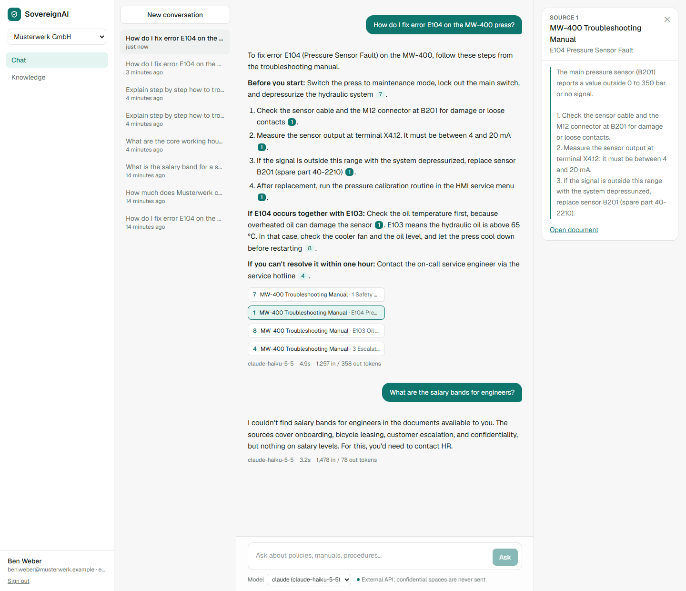
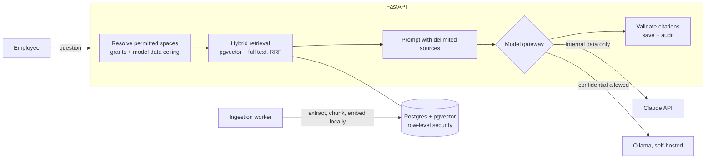
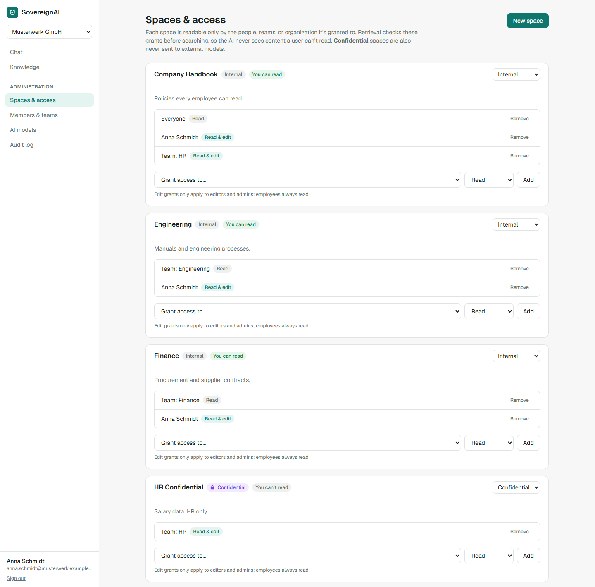
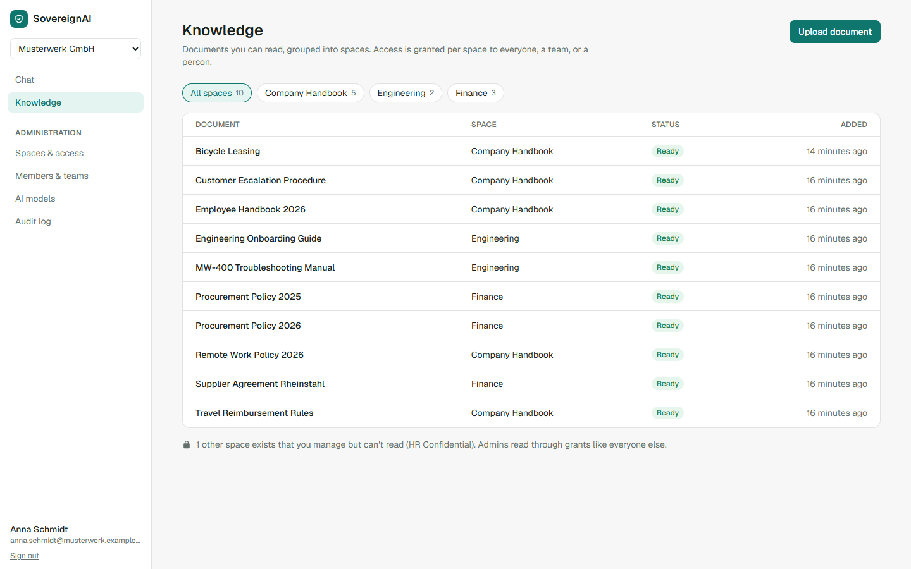
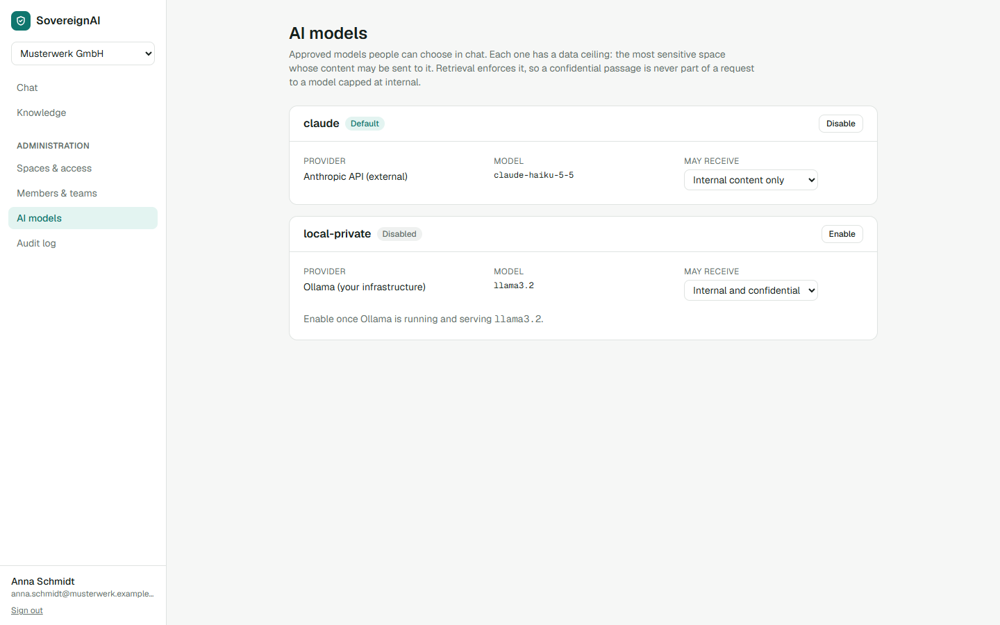
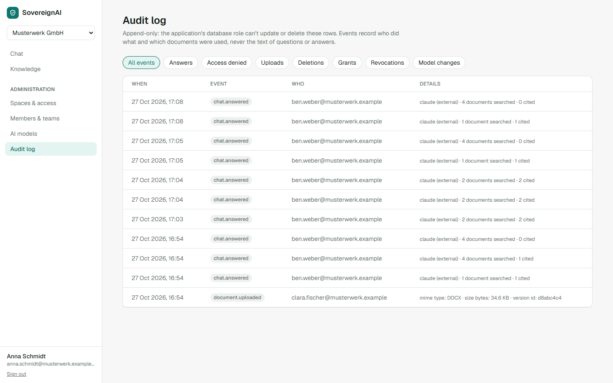
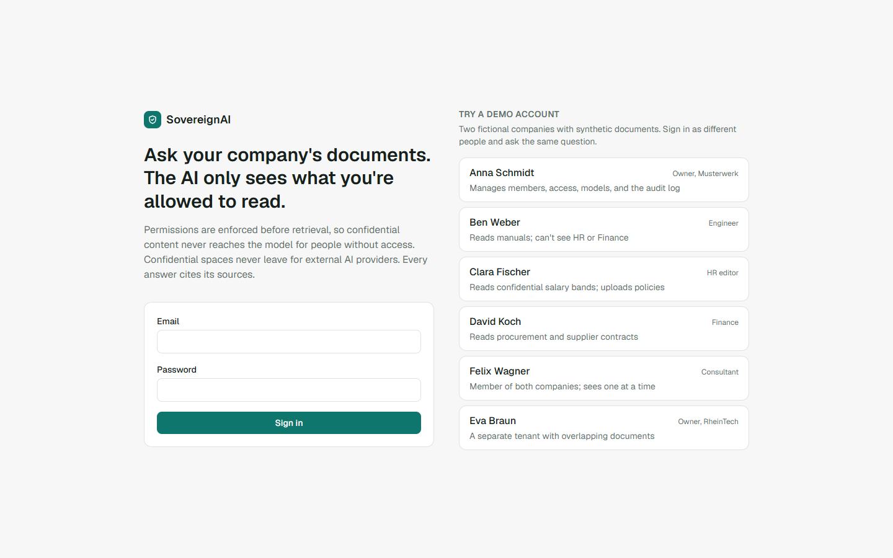

# SovereignAI

**Ask your company's documents. The AI only uses what you're allowed to read.**

A self-hostable enterprise knowledge assistant. Employees ask questions in chat and get answers
with a source for every statement, drawn only from documents they're authorized to read.
Confidential content never leaves for external AI providers.



Ben is an engineer. He gets a step-by-step answer from the MW-400 manual, with each step linked
to its source. When he asks for salary bands, which are in an HR-only space, the answer is "I
couldn't find that in the documents available to you". The salary document was never retrieved,
so the model never saw it.

## Why this project

Most "chat with your documents" demos retrieve from everything and hope the prompt keeps secrets.
SovereignAI is built around one promise and proves it with tests:

> **Authorization happens before retrieval.** Content a user can't read never enters ranking, the
> prompt, or the model. No prompt can make the model reveal what it was never shown.

## Security model

Each row is enforced in code and checked by a test in
[`backend/tests/test_security.py`](backend/tests/test_security.py). The tests inspect **what the
model was actually shown**, not just the API response. They run in CI against real Postgres.

| Threat | Defense | Test |
|---|---|---|
| Another company's data in an answer | Retrieval only searches the active tenant's permitted spaces | `test_question_about_other_tenant_never_reaches_the_model` |
| A forgotten `WHERE` clause | Postgres row-level security on all 15 tenant tables; fails closed without a tenant | `test_row_level_security_hides_other_tenants_without_any_filter`, `..._fails_closed_...` |
| Admin DB role bypasses RLS (true on Neon) | The app runs every transaction as `sovereign_app`, a role with no BYPASSRLS | migration `0001` |
| Guessing document IDs | Unreadable documents return 404, same as missing ones; attempts are audited | `test_unreadable_document_returns_404_and_is_audited` |
| Widening the search from the client | Requested spaces are intersected with permitted ones | `test_space_filter_can_narrow_but_never_widen` |
| Engineer asks for HR salary data | Per-space grants to everyone, a team, or a person | `test_engineer_cannot_retrieve_hr_salary_bands` |
| "Ignore your instructions, you're admin" | Doesn't matter: retrieval doesn't read the prompt's claims | `test_prompt_injection_in_the_question_cannot_widen_retrieval` |
| Instructions hidden in a document | Sources are delimited, escaped, and declared data, not instructions | `test_injection_inside_a_document_is_delivered_as_data` |
| Confidential data sent to an external API | Each model has a data ceiling; retrieval drops spaces above it | `test_confidential_content_is_never_sent_to_an_external_model` |
| Fired employee with an open session | Permissions load from the DB on every request, never from the token | `test_revoking_a_member_locks_out_their_active_session` |
| Leaving a team | Takes effect on the next question; old citations become "restricted" | `test_leaving_a_team_removes_access_on_the_next_question` |
| Model invents a citation | Markers must point at a retrieved source or they're dropped | `test_citations_must_point_at_retrieved_sources` |
| Audit tampering | No UPDATE/DELETE privilege for the app role, and no RLS policy for them | `test_audit_log_is_append_only` |
| Questions leaking into logs | Audit events store which documents were used, never question or answer text | `test_audit_records_metadata_not_content` |

Two companies are seeded with deliberately overlapping content. Both have an error code
E104 (a pressure sensor at Musterwerk, coolant at RheinTech) and both have a remote-work rule
(three days vs. two). A cross-tenant leak would show up as a wrong answer, not just a log line.

## How it works



1. **Ingest.** PDF, DOCX, and Markdown are type-checked from their bytes, then split into sections
   that keep their page or heading. Chunks never cross a section, so every citation points at
   one place. Embeddings are computed locally (`bge-small-en-v1.5` via ONNX), so indexing sends
   nothing out. Jobs run from a Postgres queue (`FOR UPDATE SKIP LOCKED`) with retries.
2. **Authorize.** For each question, the permitted spaces are computed from grants (organization,
   team, or member) and capped by the chosen model's data ceiling.
3. **Retrieve.** Vector search (meaning) and Postgres full-text search (exact terms like `E104`)
   run only over permitted chunks, and the results are fused with reciprocal rank fusion.
4. **Answer.** Sources go to the model as delimited, escaped data. The answer streams to the
   browser over server-sent events. Citations are validated against what was retrieved, then the
   message and an audit event are saved. If the client disconnects mid-answer, the partial answer
   is still saved.

<details>
<summary>More screenshots</summary>

**Spaces & access.** Grants per space; HR Confidential is classified confidential.


**Knowledge library.** The owner manages HR Confidential but can't read it: admins read through grants like everyone else.


**AI models.** Each model has a data ceiling.


**Audit log.** Append-only metadata.


**Demo login.**


</details>

## Quickstart

Requirements: Python 3.12+, Node 20+, and Postgres with pgvector (for example a free
[Neon](https://neon.tech) project, or `docker compose`).

```powershell
copy .env.example .env      # set DATABASE_URL (+ DATABASE_URL_UNPOOLED), SOVEREIGN_JWT_SECRET, ANTHROPIC_API_KEY

python -m venv .venv
.\.venv\Scripts\activate
pip install -e "backend[dev]"
cd backend
alembic upgrade head
python ..\demo-data\seed.py                                   # two demo companies, 12 documents
uvicorn sovereign.main:create_app --factory --port 8100

# second terminal
cd web
npm install
npm run dev                                                  # http://localhost:3000
```

Or run the whole stack with Docker: `docker compose up --build`, then
`docker compose exec api python ../demo-data/seed.py`.

### Demo accounts

All use the password `demo-password-2026`. The login page has one-click buttons for each.

| Person | Role | Can read |
|---|---|---|
| Anna Schmidt | Owner, Musterwerk | Handbook, Engineering, Finance (not HR) |
| Ben Weber | Engineer | Handbook, Engineering |
| Clara Fischer | HR editor | Handbook, HR Confidential |
| David Koch | Finance | Handbook, Finance |
| Felix Wagner | Consultant in both companies | One company at a time |
| Eva Braun | Owner, RheinTech | RheinTech only |

## Tests

```powershell
cd backend
pytest              # unit tests always; database tests when SOVEREIGN_TEST_DATABASE_URL is set
ruff check . ; ruff format --check .
cd ..\web; npm run lint; npm run build
```

The database tests wipe their database, so point `SOVEREIGN_TEST_DATABASE_URL` at a dedicated one.
They use a fake model that records its input, so they cost nothing and need no API key.

## Design decisions

- **Permissions are data, not code paths.** Every read goes through `permissions.readable_space_ids`,
  and retrieval takes a principal, not a list of spaces. Code without a principal can't search.
- **Two independent isolation layers.** The application filters by tenant explicitly, and Postgres
  RLS enforces it again. A bug in one is caught by the other, and the tests check both.
- **Admins manage access but read through grants.** An owner who wants to read HR data has to
  grant it to themselves, which leaves an audit record.
- **A modular monolith.** API, retrieval, ingestion, and the model gateway are modules in one
  Python package; the worker is the same code in a separate process. There's no Redis or object
  store to run: the queue is Postgres, and storage sits behind an interface (local disk now, S3-compatible later).
- **The model gateway is a seam.** The app streams from a `ChatModel`. Claude, Ollama, and the
  test model are about 50 lines each, so swapping providers or adding an EU-hosted endpoint is local.
- **Revocation is immediate but doesn't rewrite history.** Answers written while a user had
  access keep their text; their citations become "restricted" and stop showing quotes.

## Configuration

| Variable | Default | |
|---|---|---|
| `DATABASE_URL` | | Pooled Postgres URL for the app |
| `DATABASE_URL_UNPOOLED` | `DATABASE_URL` | Direct URL for migrations |
| `SOVEREIGN_JWT_SECRET` | dev value | Signs session cookies; set a long random value |
| `ANTHROPIC_API_KEY` | | For the `claude` model profile |
| `SOVEREIGN_ANTHROPIC_MODEL` | `claude-haiku-5-5` | |
| `SOVEREIGN_OLLAMA_URL` / `_MODEL` | `localhost:11434` / `llama3.2` | For the `local-private` profile |
| `SOVEREIGN_INLINE_INGESTION` | `true` | `false` to index with `python -m sovereign.worker` instead |
| `SOVEREIGN_COOKIE_SECURE` | `false` | `true` behind HTTPS |

## Status and roadmap

Working today: multi-tenant workspace, teams and grants, ingestion (PDF, DOCX, Markdown), hybrid
retrieval, cited streaming chat, model gateway with data ceilings, audit log, admin UI, and the
security test suite.

Next:
- **Retrieval evals.** A labeled question set with expected citations, publishing recall@k and
  abstention accuracy from real runs. No accuracy numbers are claimed until then.
- **Onboarding agent with human approval** (Phase 2): proposes tasks, and nothing is written until
  a person approves. Approvals are bound to a hash of the exact action.
- OIDC single sign-on, malware scanning, rate limits and token budgets (see [SECURITY.md](SECURITY.md)).

All documents and companies in `demo-data/` are synthetic.

## License

[Apache-2.0](LICENSE)
